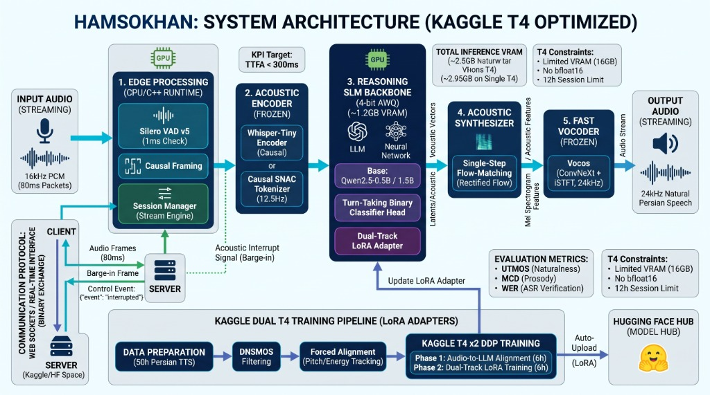

<div align="center">

# Hamsokhan (هم‌سخن)
### Ultra-Low Latency Full-Duplex Speech-to-Speech Conversational AI for Persian
**Optimized for Budget Hardware (Kaggle Dual NVIDIA Tesla T4) | Sub-300ms TTFA | Native Barge-in**

[](https://www.python.org/downloads/)
[](https://pytorch.org/)
[-76B900.svg)](https://www.nvidia.com/en-us/data-center/tesla-t4/)
[](https://huggingface.co/Abolfazl27Aflhami88/Hamsokhan)
[](https://huggingface.co/datasets/Abolfazl27Aflhami88/hamsokhan-shards)
[](LICENSE)

<br/>



</div>

---

## 📌 نمای کلی و هویت پروژه (Executive Overview)

**هم‌سخن (Hamsokhan)** یک سیستم هوش مصنوعی گفتار‌به‌گفتار (Speech-to-Speech یا STS) بی‌درنگ و تمام دوطرفه (Full-Duplex) برای زبان فارسی است که به صورت ویژه برای اجرا و آموزش پایدار بر روی **سخت‌افزارهای اقتصادی (پردازنده‌های NVIDIA Tesla T4 با حافظه محدود ۱۶ گیگابایت در کگل)** مهندسی شده است.

در مکالمات انسانی، تاخیر بیش از ۳۵۰ میلی‌ثانیه مکالمه را مصنوعی و منقطع می‌کند. هم‌سخن با گذر از پایپلاین‌های کند آبشاری گذشته (ASR $\to$ LLM $\to$ TTS) و مهاجرت به معماری یکپارچه **Hamsokhan V2**، تاخیر رسیدن به نخستین بسته صوتی (**TTFA**) را به **کمتر از ۳۰۰ میلی‌ثانیه** رسانده و از وقفه آنی و طبیعی در کلام (Barge-in) پشتیبانی می‌کند.

---

## 🚀 شاخص‌های کلیدی عملکرد (KPIs & Performance Targets)

| شاخص ارزیابی | مقدار هدف (Target) | دستاورد معماری هم‌سخن V2 |
| :--- | :---: | :--- |
| **تاخیر نخستین صوت (TTFA)** | **$< 300 \text{ ms}$** | ترکیب پروجکشن علّی، استنتاج تک‌گامه Flow و وکودر ۳ میلی‌ثانیه‌ای Vocos |
| **مصرف حافظه گرافیکی (VRAM)** | **$\sim 2.5 - 2.95 \text{ GB}$** | استنتاج کامل پایپلاین روی یک عدد کارت T4 با باقی گذاشتن ۱۳GB حافظه خالی |
| **واکنش به وقفه (Barge-in RT)** | **$< 20 \text{ ms}$** | تخلیه بلادرنگ صف وب‌سوکت با مسیر دوگانه سریع آکوستیک (Silero VAD v5) |
| **طبیعی بودن گفتار (UTMOS)** | **$> 3.65$** | حفظ لحن محاوره‌ای، احساسات و لحن گوینده تهرانی با ابعاد مل $[B, 100, T]$ |
| **سازگاری سخت‌افزاری** | **T4 FP16 (No BF16)** | پایداری محاسبات با GradScaler کالیبره‌شده، بدون سرریز گرادیان یا تولید NaN |

---

## 🏗️ ۵ لایه اصلی معماری Hamsokhan V2

معماری یکپارچه سیستم در ۵ لایه مجزا طراحی شده است:

```
[ورودی صوت: 16kHz PCM (پکت‌های 80ms)]
               │
               ▼
┌─────────────────────────────────────────────────────────────┐
│ 1. پردازش در لایه لبه (Edge Processing - CPU/C++)            │
│    • ماژول Silero VAD v5 با گام بررسی 1ms                   │
│    • فریم‌بندی علّی 80ms و مدیریت سشن استریم                │
└──────────────────────────────┬──────────────────────────────┘
                               │
                               ▼
┌─────────────────────────────────────────────────────────────┐
│ 2. انکودر صوتی منجمد (Acoustic Encoder - Frozen)             │
│    • مدل Whisper-Tiny Encoder علّی (39M پارامتر، ~300MB)    │
│    • یا توکنایزر علّی SNAC با نرخ فریم 12.5Hz               │
│    • نگاشت نرخ 50Hz به 12.5Hz با Causal Speech Projector    │
└──────────────────────────────┬──────────────────────────────┘
                               │
                               ▼
┌─────────────────────────────────────────────────────────────┐
│ 3. هسته استدلال زبانی فشرده (Reasoning SLM Backbone)         │
│    • مدل ترانسفورمر Qwen3-0.6B / Qwen2.5-0.5B (4-bit AWQ)   │
│    • آداپتور LoRA دو مسیره (Dual-Track) منطبق با فارسی      │
│    • هد طبقه‌بند باینری نوبت‌گیری (Turn-Taking Classifier)   │
└──────────────────────────────┬──────────────────────────────┘
                               │
                               ▼
┌─────────────────────────────────────────────────────────────┐
│ 4. سینت‌سایزر آکوستیک (Acoustic Synthesizer)                 │
│    • مدل تقطیرشده Single-Step Rectified Flow Matching        │
│    • تولید مل اسپکتورگرام [B, 100, T] با نسبت دقیق 15:2      │
└──────────────────────────────┬──────────────────────────────┘
                               │
                               ▼
┌─────────────────────────────────────────────────────────────┐
│ 5. وکودر فوق‌سریع منجمد (Fast Vocoder - Frozen)             │
│    • مدل Vocos 24kHz (ConvNeXt + iSTFT)                     │
│    • زمان استنتاج خیره‌کننده 3 الی 5 میلی‌ثانیه روی Tesla T4  │
└──────────────────────────────┬──────────────────────────────┘
                               │
                               ▼
[خروجی صوت: 24kHz Natural Persian Speech (Streaming)]
```

---

## ⚡ خط لوله آموزش توزیع‌شده کگل (Kaggle Dual T4 DDP Pipeline)

آموزش مدل به صورت خودکار در ۵ مرحله در نوت‌بوک کگل (`hamsokhan.ipynb`) انجام می‌گیرد:

```
[دیتاست ۵۰ ساعته فارسی] ──► [فیلتر DNSMOS] ──► [تراز زمانی Forced Alignment]
                                                        │
                                                        ▼
                                       ┌───────────────────────────────────┐
                                       │ آموزش DDP روی دو کارت Kaggle T4   │
                                       │ فاز ۱: تراز صوت به مدل زبانی (6h) │
                                       │ فاز ۲: آموزش LoRA دو مسیره (6h)  │
                                       └─────────────────┬─────────────────┘
                                                         │
                                                         ▼
                                       [آپلود خودکار به Hugging Face Hub]
                                       (Abolfazl27Aflhami88/Hamsokhan)
```

### تمهیدات مهندسی برای رفع محدودیت‌های کگل:
1. **جداسازی کش دیسک (`/kaggle/tmp`):** حل محدودیت ۲۰ گیگابایتی دیسک با انتقال کش دانلودهای Hugging Face و PyTorch به پارتیشن موقت.
2. **محاسبات اختصاصی FP16:** کالیبراسیون `GradScalerKwargs(init_scale=2**14)` و فعال‌سازی `expandable_segments:True` برای پیشگیری از خطای عدم وجود bfloat16 در کارت‌های سری Turing T4.
3. **حل بن‌بست ارتباطی NCCL:** اعمال پرچم‌های `NCCL_P2P_DISABLE=1` و `NCCL_IB_DISABLE=1` جهت برقراری پایدار DDP بین دو شتاب‌دهنده گرافیکی.
4. **ریسه بکاپ ناهمگام (Async Thread):** ذخیره هر ۵۰۰ گام به صورت `.safetensors` و آپلود مداوم به Hugging Face برای مقابله با سقف ۱۲ ساعته سشن‌های کگل.

---

## 🌐 قرارداد پروتکل ارتباطی وب‌سوکت (WebSocket Protocol & Barge-in)

ارتباط کلاینت و سرور به صورت باینری خالص و بدون سربار متنی طراحی شده است:

* **کلاینت به سرور (Ingress):** استریم بسته‌های باینری `16kHz PCM, 16-bit, Mono` (اندازه هر فریم: ۸۰ میلی‌ثانیه = ۲۵۶۰ بایت).
* **سرور به کلاینت (Egress):** استریم بسته‌های باینری سنتز شده `24kHz PCM, 16-bit, Mono` (اندازه هر فریم: ۸۰ میلی‌ثانیه = ۳۸۴۰ بایت).
* **مسیر دوگانه وقفه (Dual-Track Barge-in):**
  - **Acoustic Fast-Path:** ردیابی صدا توسط Silero VAD v5 روی CPU در کمتر از ۱۰ میلی‌ثانیه ($P > 0.6$).
  - **Semantic Confirmation:** اعتبارسنجی نیت صحبت از سوی هد نوبت‌گیری جهت تفکیک وقفه‌های گذرا و تاییدی (Backchanneling نظیر «آره»، «خب»).
* **برش کانتکست (KV-Cache Truncation):** بر اساس فیلد `client_playback_sample` اعلامی از کلاینت، توکن‌های زبانی و صوتی که کاربر نشنیده از حافظه مدل پاک می‌شوند.

---

## 📂 ساختار مخزن و مستندات تخصصی (Repository Structure)

```
.
├── assets/
│   └── hamsokhan_architecture.jpg     # دیاگرام جامع معماری سیستم
├── configs/
│   └── config.yaml                    # پیکربندی سرور، VAD، ابعاد مدل و فرکانس صوتی
├── docs/
│   ├── ARCHITECTURE.md                # مستند فنی عمیق، فرمول‌های ریاضی و تحلیل بودجه Latency/VRAM
│   ├── WEBSOCKET_PROTOCOL.md          # مشخصات فریم‌های باینری، پیام‌های کنترلی JSON و استراتژی وقفه
│   ├── KAGGLE_TRAINING.md             # راهنمای کامل آموزش موازی DDP روی دو کارت T4 و مهار چالش‌ها
│   ├── ROADMAP.md                     # گزارش تحویل فنی، وضعیت ماژول‌ها و نقشه راه کامیت‌ها
│   └── EVALUATION.md                  # مشخصات متدها و متریک‌های ارزیابی (UTMOS، MCD، WER، TTFA)
├── scripts/
│   ├── kaggle_dataset_builder.py      # خط لوله تولید شاردهای صوتی باینری safetensors
│   ├── eval_hamsokhan.py              # ارزیابی خودکار متریک‌ها و ارتقای چک‌پوینت نهایی
│   └── setup_nvidia_mps.sh            # پیکربندی NVIDIA MPS برای مالتی‌پراسسینگ
├── src/
│   ├── data/                          # ماژول‌های لودر شاردها، استخراج مل و برچسب‌زن PersianVox
│   ├── models/                        # پروجکتور علّی، هد نوبت‌گیری و سینت‌سایزر Flow
│   ├── pipeline/                      # ارکستریتور و مدیریت نوبت‌های گفتار
│   ├── transport/                     # گیت‌وی وب‌سوکت تمام دوطرفه و کلاینت ماک
│   └── vad/                           # لایه تشخیص فعالیت صوتی Silero VAD
├── tests/                             # آزمون‌های واحد علّی، پایداری استپ و تاخیر وقفه
├── hamsokhan_model.py                 # پیاده‌سازی ترانسفورمر یکپارچه Hamsokhan V2
├── train_hamsokhan_ddp.py             # اسکریپت آموزش توزیع‌شده DDP با شتاب‌دهنده accelerate
├── main.py                            # سوپروایزر راه‌اندازی و اجرای پروداکشن
├── requirements.txt                   # وابستگی‌های پایتون
└── README.md                          # این سند
```

---

## 🗺️ نقشه راه کامیت‌های بعدی (Development Roadmap)

بر اساس آخرین گزارش وضعیت مهندسی، برنامه‌ریزی کامیت‌های بعدی به شرح زیر تنظیم شده است:

- [ ] **`COMMIT-01`**: تکمیل پدینگ علّی (`causal_padding`) و تضمین محاسبات FP32 در لایه‌های آکوستیک `hamsokhan_model.py`.
- [ ] **`COMMIT-02`**: بازنویسی ارکستریتور استریمینگ (`src/pipeline/orchestrator.py`) برای پردازش بلادرنگ بدون مرحله متن واسط.
- [ ] **`COMMIT-03`**: ارتقای پروتکل وب‌سوکت و هندلر وقفه باینری/JSON در `src/transport/websocket_server.py`.
- [ ] **`COMMIT-04`**: اضافه کردن سوییت تست‌های واحد و یکپارچگی علّی و تاخیر در دایرکتوری `tests/`.
- [ ] **`COMMIT-05`**: اجرای شاردینگ و ساخت بسته‌ها در کگل و ارسال به مخزن `Abolfazl27Aflhami88/hamsokhan-shards`.
- [ ] **`COMMIT-06`**: آغاز آموزش رسمی DDP روی دو کارت T4، ثبت وزن‌ها در هاب و گزارش نهایی متریک‌ها.

---

## 🔗 مخازن و لینک‌های مرجع (External Links)

* **مدل‌ها در Hugging Face Hub:** [huggingface.co/Abolfazl27Aflhami88/Hamsokhan](https://huggingface.co/Abolfazl27Aflhami88/Hamsokhan)
* **دیتاست شاردها در Hugging Face:** [huggingface.co/datasets/Abolfazl27Aflhami88/hamsokhan-shards](https://huggingface.co/datasets/Abolfazl27Aflhami88/hamsokhan-shards)
* **مستندات معماری سیستم:** [docs/ARCHITECTURE.md](docs/ARCHITECTURE.md)
* **مشخصات پروتکل وب‌سوکت:** [docs/WEBSOCKET_PROTOCOL.md](docs/WEBSOCKET_PROTOCOL.md)
* **راهنمای آموزش در کگل:** [docs/KAGGLE_TRAINING.md](docs/KAGGLE_TRAINING.md)
* **گزارش وضعیت و کارهای باز:** [docs/ROADMAP.md](docs/ROADMAP.md)

---

## 📄 مجوز (License)

این پروژه تحت مجوز [MIT License](LICENSE) منتشر شده است.
