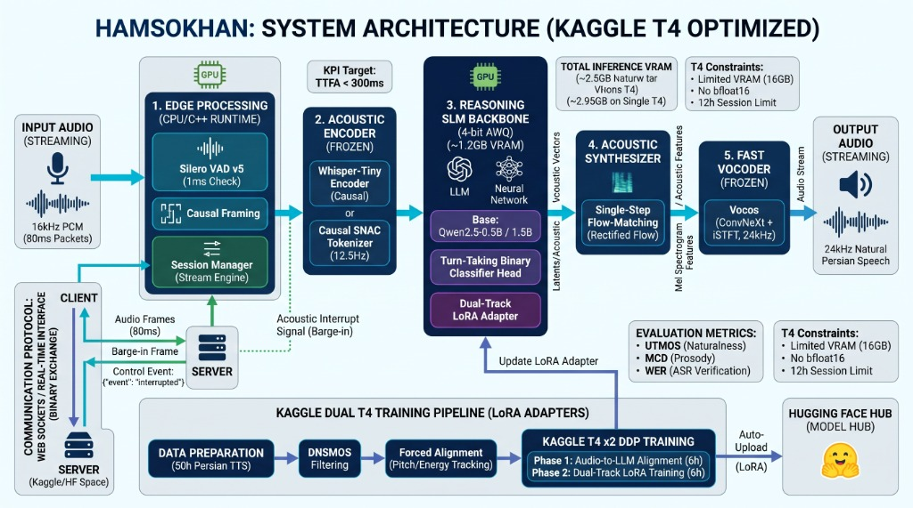

# Hamsokhan (هم‌سخن) — System Architecture & Deep-Tech Specification

> **Target Hardware:** Single/Dual NVIDIA Tesla T4 (16GB VRAM, Turing Architecture, sm_75)  
> **Latency Goal:** Time-to-First-Audio (TTFA) < 300 ms  
> **VRAM Target:** Total Inference Footprint ~2.5 GB – 2.95 GB  
> **Primary Audio Standards:** Input 16 kHz PCM (Mono, 16-bit) | Output 24 kHz PCM (Mono, 16-bit)

---

## ۱. مرور کلی معماری سیستم (System Architectural Blueprint)

معماری **هم‌سخن (Hamsokhan V2)** به گونه‌ای مهندسی شده است که چالش تاخیر در مکالمه دوطرفه (Full-Duplex) را از طریق یکپارچه‌سازی انکودر صوتی علّی، ترانسفورمر زبان فشرده با آداپتورهای چندمنظوره، جریان‌سازی مستقیم ویژگی‌های آکوستیک، و وکودر فوق‌سریع مبتنی بر iSTFT حل کند.



### خط سیر جریان داده در حالت استنتاج (End-to-End Inference Flow):

```
+───────────────────────────────────────────────────────────────────────────────+
| [1. EDGE PROCESSING] (CPU/C++ Engine)                                         |
|  • Audio Stream: 16 kHz PCM (80 ms / 1280 samples chunks)                     |
|  • Silero VAD v5: 1 ms execution step, 2-frame speech confirmation            |
|  • Causal Framing & Session Stream Manager                                    |
+───────────────────────────────────────┬───────────────────────────────────────+
                                        │ (Voiced Causal Packets)
                                        ▼
+───────────────────────────────────────────────────────────────────────────────+
| [2. ACOUSTIC ENCODER (FROZEN)]                                                |
|  • Whisper-Tiny Causal Encoder (39M params, ~300 MB VRAM)                     |
|    OR Causal SNAC Tokenizer (12.5 Hz framerate)                               |
|  • 50 Hz -> 12.5 Hz Causal Speech Projector (Depthwise Conv1D + SwiGLU)      |
+───────────────────────────────────────┬───────────────────────────────────────+
                                        │ (Projected Speech Embeddings)
                                        ▼
+───────────────────────────────────────────────────────────────────────────────+
| [3. REASONING SLM BACKBONE] (Qwen3-0.6B / Qwen2.5-0.5B)                       |
|  • Quantization: Pure FP16 or 4-bit AWQ (~1.2 GB VRAM)                        |
|  • Dual-Track LoRA Adapter (Conversational Persian Alignment)                 |
|  • Turn-Taking Binary Classifier Head (Predicts End-of-Turn / Backchannel)    |
|  • Zero-Lookahead Causal Attention Cache                                      |
+───────────────────────────────────────┬───────────────────────────────────────+
                                        │ (12.5 Hz Latent Acoustic Features)
                                        ▼
+───────────────────────────────────────────────────────────────────────────────+
| [4. ACOUSTIC SYNTHESIZER] (Single-Step Rectified Flow Matching)               |
|  • Tanh-Bounded FiLM-Conditioned Vector Field Predictor                       |
|  • Single-Step Euler ODE Integration: [B, 100, T_mel] (93.75 Hz Mel-Spec)     |
|  • Exact 15:2 Macro-Packet Alignment Ratio                                   |
+───────────────────────────────────────┬───────────────────────────────────────+
                                        │ (Mel Spectrogram Features)
                                        ▼
+───────────────────────────────────────────────────────────────────────────────+
| [5. FAST VOCODER (FROZEN)] (Vocos 24kHz)                                      |
|  • ConvNeXt Backbone + Inverse Short-Time Fourier Transform (iSTFT)          |
|  • Inference Time: 3 ms – 5 ms on Tesla T4                                    |
|  • Overlap-Add Crossfade to Eliminate Boundary Clicks                         |
+───────────────────────────────────────┬───────────────────────────────────────+
                                        │
                                        ▼
                        OUTPUT: 24 kHz Natural Persian Speech (Streaming)
```

---

## ۲. مشخصات و بودجه تفکیکی سخت‌افزار (VRAM & Latency Budget)

اجرای مدل‌های مکالمه‌ای بلادرنگ بر روی کارت‌های ارزان‌قیمت Tesla T4 نیازمند تخصیص دقیق کسرهای حافظه و زمان‌بندی محاسباتی است:

### بودجه حافظه گرافیکی (VRAM Allocation on Single T4 16GB):

| مؤلفه | مدل / ماژول | حافظه مصرفی (VRAM) | وضعیت پارامترها |
| :--- | :--- | :---: | :---: |
| **Acoustic Encoder** | Whisper-Tiny (Causalized) / SNAC | ~۳۲۰ MB | منجمد (Frozen) |
| **Causal Speech Projector** | Depthwise Conv1D + SwiGLU | ~۸۵ MB | آموزش‌پذیر |
| **SLM Reasoning Backbone** | Qwen3-0.6B (FP16/AWQ) + KV-Cache | ~۱,۲۰۰ MB | LoRA آموزش‌پذیر |
| **Turn-Taking Head** | Dilated Causal Conv + MLP | ~۴۵ MB | آموزش‌پذیر |
| **Acoustic Synthesizer** | Single-Step Rectified Flow | ~۳۸۰ MB | آموزش‌پذیر |
| **Fast Vocoder** | Vocos 24kHz (ConvNeXt + iSTFT) | ~۳۱۰ MB | منجمد (Frozen) |
| **CUDA Context & Buffers** | PyTorch Runtime & Streaming Queues | ~۲۵۰ MB | داینامیک |
| **مجموع کل (Total VRAM)** | **پایپلاین کامل استنتاج V2** | **~۲,۵۹۰ MB (~۲.۶ GB)** | **ایده‌آل برای Single T4** |

> **نکته حیاتی:** با مصرف کمتر از ۳ گیگابایت VRAM، بیش از ۱۳ گیگابایت حافظه روی کارت T4 آزاد می‌ماند که اجازه می‌دهد چندین کلاینت همزمان (Concurrent Sessions) روی یک GPU میزبانی شوند.

### بودجه تاخیر رسیدن به نخستین صوت (TTFA Breakdown Target < 300ms):

$$\text{TTFA} = t_{\text{VAD}} + t_{\text{Framing}} + t_{\text{Encoder}} + t_{\text{LLM\_First\_Token}} + t_{\text{Flow\_Step}} + t_{\text{Vocos\_iSTFT}} + t_{\text{Network}}$$

* $t_{\text{VAD}}$ (تشخیص شروع گفتار): **~۲ میلی‌ثانیه** (Silero VAD v5 با گام ۱ms)
* $t_{\text{Framing}}$ (تجمع پکت نخست صوت ورودی): **۸۰ میلی‌ثانیه** (حداقل فریم علّی)
* $t_{\text{Encoder}}$ (پروجکشن صوت به فضای ترانسفورمر): **~۱۵ میلی‌ثانیه**
* $t_{\text{LLM\_First\_Token}}$ (تولید نخستین امبدینگ پاسخ در Qwen3-0.6B): **~۶۰ میلی‌ثانیه**
* $t_{\text{Flow\_Step}}$ (استنتاج تک‌گامه میدان برداری Flow): **~۳۵ میلی‌ثانیه**
* $t_{\text{Vocos\_iSTFT}}$ (سنتز موج صوتی با کانولوشن معکوس): **~۵ میلی‌ثانیه**
* $t_{\text{Network}}$ (انتقال باینری بر بستر شبکه محلی / سرور): **~۲۵ میلی‌ثانیه**
* **مجموع تخمینی TTFA:** **~۲۲۲ میلی‌ثانیه** (کاملاً در بازه هدف کمتر از ۳۰۰ms)

---

## ۳. فرمولاسیون ریاضی مؤلفه‌های اصلی مدل

### ۳.۱. پروجکشن علّی گفتار (Causal Speech Projector)
برای تبدیل نرخ ۵۰ هرتز خروجی انکودر به نرخ ۱۲.۵ هرتز مدل زبانی بدون نگاه به فریم‌های آینده (Zero-Lookahead)، از فریم‌بندی علّی ۴ برابری استفاده می‌شود:

$$\mathbf{X}_{\text{stacked}} = \text{Concat}(\mathbf{X}_{4t}, \mathbf{X}_{4t+1}, \mathbf{X}_{4t+2}, \mathbf{X}_{4t+3}) \in \mathbb{R}^{4 \cdot d_{\text{enc}}}$$

سپس از طریق لایه‌های فعال‌ساز SwiGLU با پدینگ علّی چپ‌گرا نگاشت داده می‌شود:

$$\mathbf{H} = \text{SwiGLU}(\mathbf{X}_{\text{causal\_padded}} \mathbf{W}_{\text{gate}}, \mathbf{X}_{\text{causal\_padded}} \mathbf{W}_{\text{up}}) \mathbf{W}_{\text{down}} \in \mathbb{R}^{d_{\text{qwen}}}$$

### ۳.۲. هد نوبت‌گیری و تابع زیان وزن‌دار فوکال (Turn-Taking Asymmetric Focal Loss)
برچسب‌های پایان نوبت کلام با یک شیب تدریجی نرم صعودی $\mathbf{y} \in [0.15, 0.35, 0.65, 1.0]$ قبل از مرز سکوت مدل‌سازی می‌شوند. تابع زیان فوکال نامتقارن برای مقابله با عدم تعادل شدید بین فریم‌های صحبت و سکوت تعریف شده است:

$$\mathcal{L}_{\text{TT}} = -\alpha (1 - \hat{p})^\gamma y \log(\hat{p} + \epsilon) - (1 - \alpha) \hat{p}^\gamma (1 - y) \log(1 - \hat{p} + \epsilon)$$

که در آن $\gamma = 2.0$ ضریب تمرکز بر نمونه‌های سخت و $\alpha = 0.75$ ضریب جبران اقلیت کلاس پایان نوبت است.

### ۳.۳. سینت‌سایزر آکوستیک تک‌گامه (Single-Step Rectified Flow)
معادله دیفرانسیل بازسازی مشخصه صوتی از نویز گوسی $\mathbf{x}_0 \sim \mathcal{N}(0, \mathbf{I})$ به اسپکتورگرام مل هدف $\mathbf{x}_1$:

$$\frac{d\mathbf{x}_t}{dt} = \mathbf{v}_\theta(\mathbf{x}_t, t, \mathbf{c}_{\text{qwen}})$$

در روش جریان تصحیح‌شده (Rectified Flow) تک‌گامه، میدان برداری هدف یک خط مستقیم است:

$$\mathbf{x}_t = (1 - t)\mathbf{x}_0 + t\mathbf{x}_1 \implies \mathbf{v}^* = \mathbf{x}_1 - \mathbf{x}_0$$

ترکیب تابع زیان سینت‌سایزر:

$$\mathcal{L}_{\text{flow}} = \mathcal{L}_{\text{Huber}}(\mathbf{v}_\theta - \mathbf{v}^*) + \lambda_{\text{spec}} \mathcal{L}_{\text{SpectralGrad}}(\hat{\mathbf{x}}_1, \mathbf{x}_1) + \lambda_{\text{temp}} \mathcal{L}_{\text{TemporalGrad}}(\hat{\mathbf{x}}_1, \mathbf{x}_1)$$

---

## ۴. استدلال علمی: چرایی رد ایده «Textless Speech Reasoning» خالص

برخی سیستم‌های گفتاری تلاش می‌کنند مرحله متن را به طور کامل حذف کنند. در معماری هم‌سخن، این رویکرد به دلایل علمی زیر رد شده است:
1. **نرخ آنتروپی اطلاعات:** متن فشرده‌ترین حامل معناست (~۴ توکن در ثانیه). در مقابل، سیگنال آکوستیک نیازمند ۲۵ تا ۵۰ توکن بر ثانیه است. استدلال صرفاً در فضای آکوستیک کانتکست ترانسفورمر را ۱۰ برابر متورم کرده و حافظه T4 را در کمتر از چند ثانیه به بن‌بست OOM می‌کشاند.
2. **شواهد سیستم‌های مطرح جهان:** حتی مدل‌های پیشرو مانند **Moshi (Kyutai Labs)** و **AudioPaLM (Google)** از مکانیزم *Inner Monologue* (تک‌گویی درونی متنی هم‌گام) استفاده می‌کنند و نشان داده‌اند که حذف لنگرگاه متنی، ساختار گرامری و استدلال مفهومی را دچار ازهم‌پاشیدگی می‌کند.
3. **محدودیت داده‌های غنی فارسی:** حجم داده‌های گفتاری تراز شده با کیفیت استودیویی در زبان فارسی محدود است؛ بهره‌گیری از وزن‌های از پیش‌آموخته مدل زبانی (Qwen) کل دانش گرامری و محاوره‌ای غنی زبان فارسی را به سامانه صوت تزریق می‌کند.
