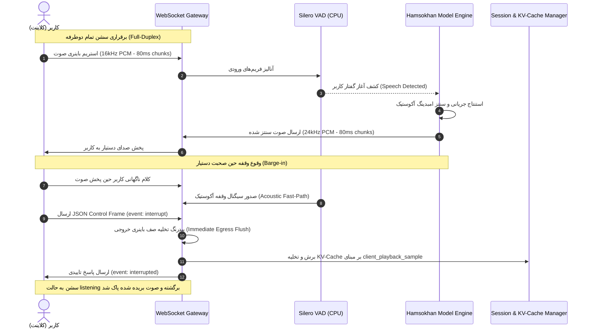

# Hamsokhan (هم‌سخن) — Real-Time WebSocket Protocol & Interruption Specification

> **Protocol Version:** 2.0 (Binary Streaming & Dual-Track Barge-in)  
> **Network Layer:** WebSockets (RFC 6455)  
> **Audio Encodings:** Raw Linear PCM 16-bit Signed Integer (Little-Endian)

---

## ۱. نمای کلی معماری ارتباطی (Communication Overview)

در سامانه **هم‌سخن**، ارتباط بین مرورگر/کلاینت (Web, Mobile, SIP) و سرور مدل به صورت **تمام دوطرفه هم‌زمان (Full-Duplex)** از طریق یک سشن دائمی وب‌سوکت برقرار می‌شود. این کانال به دو لایه مجزا تقسیم شده است:
1. **جریان فریم‌های صوتی باینری (High-Frequency Binary Audio Stream):** انتقال صوت خام با بسته‌های زمانی کوتاه ۸۰ میلی‌ثانیه‌ای بدون سربار سربسته‌های متنی.
2. **جریان رویدادهای کنترلی (JSON Control Frames):** تبادل سیگنال‌های مربوط به وقفه در کلام (Barge-in)، وضعیت نوبت‌گیری و تله‌متری عملکرد مدل.



---

## ۲. مشخصات بسته‌های باینری صوتی (Binary Audio Contracts)

برای کاهش تاخیر انتقال و حذف سربار تبدیل Base64 یا JSON، انتقال امواج صوتی منحصراً به صورت باینری خالص (`ArrayBuffer` / `bytes`) انجام می‌گیرد:

### ۲.۱. جریان ورودی (Client $\to$ Server Ingress):
* **نرخ نمونه‌برداری:** $16,000 \text{ Hz}$ (۱۶ کیلوهرتز)
* **قالب نمونه‌ها:** ۱۶ بیتی علامت‌دار، لیتل اندین (`int16_le`)
* **تعداد کانال:** تک کاناله (مونو / ۱ کانال)
* **دوره فریم‌ها:** ۸۰ میلی‌ثانیه ($0.080 \text{ sec}$)
* **تعداد نمونه‌ها در هر بسته:**
  $$\text{Samples per chunk} = 16,000 \times 0.080 = 1,280 \text{ samples}$$
* **اندازه دقیق بسته باینری:**
  $$\text{Byte size} = 1,280 \times 2 \text{ bytes} = 2,560 \text{ bytes}$$

### ۲.۲. جریان خروجی (Server $\to$ Client Egress):
* **نرخ نمونه‌برداری:** $24,000 \text{ Hz}$ (۲۴ کیلوهرتز خروجی Vocos)
* **قالب نمونه‌ها:** ۱۶ بیتی علامت‌دار، لیتل اندین (`int16_le`)
* **تعداد کانال:** تک کاناله (مونو / ۱ کانال)
* **دوره فریم‌ها:** ۸۰ میلی‌ثانیه ($0.080 \text{ sec}$)
* **تعداد نمونه‌ها در هر بسته:**
  $$\text{Samples per chunk} = 24,000 \times 0.080 = 1,920 \text{ samples}$$
* **اندازه دقیق بسته باینری:**
  $$\text{Byte size} = 1,920 \times 2 \text{ bytes} = 3,840 \text{ bytes}$$

---

## ۳. قرارداد پیام‌های کنترلی (JSON Control Frames)

پیام‌های کنترلی برای مدیریت رویدادهای سشن و قطع کلام از طریق فریم‌های متنی وب‌سوکت ارسال می‌شوند:

### ۳.۱. پیام اعلام وقفه از کلاینت به سرور (`interrupt`):
این پیام زمانی ارسال می‌شود که سمت کلاینت با ردیابی صدا یا دکمه رابط کاربری تشخیص می‌دهد که کاربر شروع به صحبت کرده و صدای دستیار باید فوراً ساکت شود:

```json
{
  "type": "control",
  "event": "interrupt",
  "timestamp_ms": 1714567890123,
  "client_playback_sample": 19200
}
```
* **`client_playback_sample`:** موقعیت دقیق آخرین نمونه صوتی ۲۴ کیلوهرتز که توسط بلندگوی کاربر پخش شده است. این فیلد برای هماهنگ‌سازی سابقه مکالمه حیاتی است.

### ۳.۲. پاسخ فوری تایید وقفه از سرور به کلاینت (`interrupted`):
سرور بیدرنگ پس از پاکسازی صف‌ها این پیام را ارسال می‌کند:

```json
{
  "type": "control",
  "event": "interrupted",
  "cleared_samples": 38400,
  "session_state": "listening"
}
```
* **`cleared_samples`:** تعداد نمونه‌های صوتی سنتز شده‌ای که در صف بافر سرور مانده بودند و بدون ارسال به کاربر دور ریخته شدند.
* **`session_state`:** وضعیت سرور فوراً به `listening` بازمی‌گردد تا به کلام جدید گوش دهد.

### ۳.۳. پیام تله‌متری و پایش لحظه‌ای عملکرد (`telemetry`):
سرور در انتهای هر نوبت یا به صورت دوره‌ای آمار زمان‌بندی را گزارش می‌دهد:

```json
{
  "type": "telemetry",
  "ttfa_ms": 235,
  "turn_taking_prob": 0.89,
  "vram_allocated_mb": 2450
}
```

---

## ۴. سازوکار وقفه دوگانه (Dual-Track Barge-in Mechanism)

سیستم هم‌سخن وقفه کلام را از طریق دو مسیر موازی و مکمل مدیریت می‌کند:

```
                                ورودی صوت کاربر
                                       │
            ┌──────────────────────────┴──────────────────────────┐
            ▼                                                     ▼
    [Acoustic Fast-Path]                               [Semantic Confirmation]
  • تحلیل در سطح CPU با Silero VAD v5               • تحلیل در سطح ترانسفورمر زبانی
  • سرعت واکنش: کمتر از ۱۰ میلی‌ثانیه                • سرعت واکنش: ۸۰ الی ۱۲۰ میلی‌ثانیه
  • پکت‌های ۸۰ms با آستانه P > 0.6                  • بررسی بردار نهفته توسط Turn-Taking Head
  • فورا صف خروجی وب‌سوکت را قطع می‌کند             • فیلتر کردن صداهای تاییدیه کوتاه (Backchannel)
```

### استراتژی هماهنگ‌سازی حافظه و برش کانتکست (State & KV-Cache Truncation):
یکی از مشکلات متداول در سیستم‌های گفتار، ناهماهنگی متن در هنگام قطع کلام است (مدل پاسخی طولانی آماده کرده اما کاربر تنها ۲ ثانیه از آن را شنیده و ناگهان صحبت کرده است).  
در هم‌سخن، به کمک شاخص `client_playback_sample`:
1. نمونه‌های پخش‌شده توسط کاربر به زمان ($t = \frac{\text{samples}}{24000}$) و تعداد توکن‌های صوتی/زبانی متناظر نگاشت می‌شوند.
2. تمام لایه‌های کش کلید-مقدار (KV-Cache) مدل زبانی برای توکن‌هایی که در زمان $t > t_{\text{interrupted}}$ بودند حذف (Truncate) می‌شوند.
3. در نوبت بعدی مکالمه، مدل فرض می‌کند که کاربر تنها همان بخش شنیده‌شده را دریافت کرده است، و از ایجاد پاسخ‌های متناقض یا توهمی جلوگیری می‌شود.
